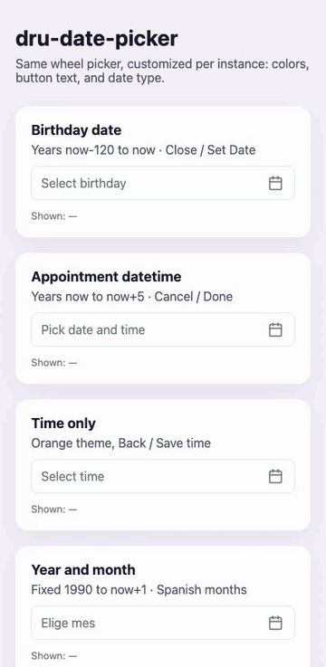

# dru-date-picker

iOS-style wheel date/time picker for **Vue 3**, **React**, **Next.js**, **Nuxt 3**, and **vanilla JavaScript**.

Every instance can set its own **colors**, **button text**, and **date type**.

<p align="center">
  
</p>

## Install

```bash
npm install dru-date-picker
```

Import styles once if you are not using the JS entry that injects them automatically:

```js
import 'dru-date-picker/style.css'
```

The web component also injects the CSS the first time it mounts, so a separate import is optional.

## Customization

| Option | Default | What it does |
| --- | --- | --- |
| `mode` | `'date'` | `'date'`, `'datetime'`, `'time'`, or `'year-month'` |
| `format` | depends on mode | Display format, e.g. `DD-MM-YYYY` or `DD-MM-YYYY HH:mm` |
| `valueFormat` | depends on mode | Value emitted on confirm |
| `confirmText` | `Set Date` | Right toolbar button |
| `cancelText` | `Close` | Left toolbar button |
| `label` | `''` | Toolbar title |
| `placeholder` | `Select Date` | Input placeholder |
| `locale` | `en` | Month names via `Intl` |
| `months` | from locale | Override the 12 month labels |
| `minYear` / `maxYear` | `1920` / `now` | Year wheel bounds. Number, `'now'`, or `'now-120'` / `'now+5'` |
| `minYearOffset` / `maxYearOffset` | — | Offset from the current year, e.g. `-100` and `5` |
| `minDate` / `maxDate` | — | Optional date bounds |
| `accentColor` | `#4e169c` | Buttons, title, selected item |
| `textColor` | `#333333` | Input text |
| `mutedColor` | `#6b7280` | Unselected wheel items |
| `panelBackground` | `#ffffff` | Panel and input |
| `highlightColor` | `rgba(78, 22, 156, 0.08)` | Center highlight |
| `backdropColor` | `rgba(24, 34, 48, 0.36)` | Mobile sheet overlay |
| `borderColor` | `#e5e7eb` | Borders |

You can also set the same colors with CSS variables on the host:

```css
dru-date-picker {
  --dru-accent: #0ea5e9;
  --dru-highlight: rgba(14, 165, 233, 0.12);
}
```

Each instance sets its own year range. Bounds are resolved when the picker opens, so `'now'` always means the current year.

```js
// Birthday: 120 years back through this year
minYear: 'now-120',
maxYear: 'now',

// Booking: this year through 5 years ahead
minYear: 'now',
maxYear: 'now+5',

// Age gate: 18+
minYearOffset: -120,
maxYearOffset: -18,

// Fixed years
minYear: 2000,
maxYear: 2030,
```

```html
<dru-date-picker min-year="now-100" max-year="now+2"></dru-date-picker>
```

Legacy props from the original Vue component still work: `showTime`, `formatToShow`, `formatToResponse`, `confirmLabel`, `birthday`, `startDate`.

## Vue 3

```js
import { createApp } from 'vue'
import DruDatePicker from 'dru-date-picker/vue'

const app = createApp(App)
app.use(DruDatePicker)
```

```html
<DruDatePicker
  v-model="date"
  mode="datetime"
  format="DD-MM-YYYY HH:mm"
  min-year="now"
  max-year="now+5"
  confirm-text="Done"
  cancel-text="Cancel"
  accent-color="#0ea5e9"
/>
```

Or import the component directly:

```js
import { DruDatePicker } from 'dru-date-picker/vue'
```

## Nuxt 3

```js
export default defineNuxtConfig({
  modules: ['dru-date-picker/nuxt'],
})
```

Then use `<DruDatePicker v-model="date" mode="date" />` in any page or component.

## React

```jsx
import { useState } from 'react'
import { DruDatePicker } from 'dru-date-picker/react'

export function Example() {
  const [date, setDate] = useState('')

  return (
    <DruDatePicker
      value={date}
      onChange={setDate}
      mode="date"
      minYear="now-120"
      maxYear="now"
      confirmText="Save"
      cancelText="Close"
      accentColor="#4e169c"
    />
  )
}
```

## Next.js

Use the Next entry so the picker only mounts in the browser. That avoids App Router / SSR errors with the custom element.

```jsx
'use client'

import { useState } from 'react'
import { DruDatePicker } from 'dru-date-picker/next'

export default function BirthdayField() {
  const [date, setDate] = useState('')

  return (
    <DruDatePicker
      value={date}
      onChange={setDate}
      mode="date"
      minYear="now-120"
      maxYear="now"
      confirmText="Set Date"
      cancelText="Close"
      accentColor="#4e169c"
    />
  )
}
```

Works with the App Router and the Pages Router. Import it from a Client Component, or keep `'use client'` on the file that renders it.

## Vanilla JavaScript

```js
import { createDatePicker } from 'dru-date-picker'

const picker = createDatePicker('#dob', {
  mode: 'date',
  format: 'DD-MM-YYYY',
  minYear: 'now-120',
  maxYear: 'now',
  confirmText: 'Save',
  cancelText: 'Close',
  accentColor: '#4e169c',
})

// Change bounds later without recreating the picker
picker.setYearBounds(2000, 'now+2')

picker.on('change', (event) => {
  console.log(event.detail.value, event.detail.date)
})
```

You can also drop the custom element in HTML after importing the package:

```html
<dru-date-picker
  mode="time"
  confirm-text="Save time"
  cancel-text="Back"
  accent-color="#c2410c"
></dru-date-picker>
```

## Events

- `change` — `{ value, date, iso }` after confirm
- `confirm` — same payload
- `cancel`
- `open`
- `close`

`onTick` is an optional callback fired as a wheel item crosses the center. Use it for haptics or other native feedback.

## Local demo

```bash
npm install
npm run dev
```

## License

MIT
